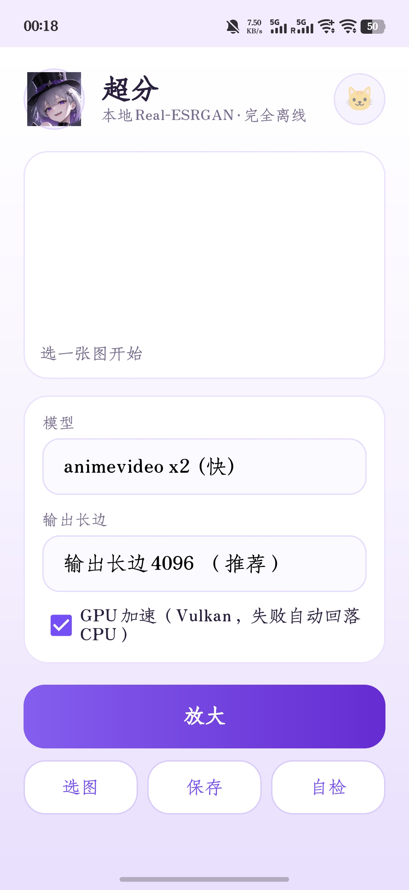

# SR 超分 — Android 本地 Real-ESRGAN

（大肥鱼出品，人类只进行部分调整和注释）
纯本地、离线、无需联网的图片超分 App。ncnn + Vulkan（不可用时回落 CPU），
模型打包进 APK，装完即用。

<p align="center">
  
</p>

## 功能

- 四个内置模型：`animevideo x2/x3/x4`（快）与 `anime6B x4`（画质）
- 从相册选图，或从别的 App 分享图片进来
- 输出长边上限可选：2048 / 3072 / 4096 / 5120
- GPU（Vulkan）优先，失败或结果异常自动回落 CPU
- 结果保存到 `相册/SR/`
- 内置「自检」：跑一张合成渐变图，报告模型/后端的真实状态

## 产物

```
SR.apk      默认只含 arm64-v8a，约 28MB
SR.apk      加 -IncludeX86 后含 x86_64，约 59MB（仅模拟器需要）
```

内置模型（`app/src/main/assets/models/`）：

| 模型 | 倍率 | 体积 | 说明 |
|---|---|---|---|
| `realesr-animevideov3-x2` | 2x | 1.2 MB | 最快，默认 |
| `realesr-animevideov3-x3` | 3x | 1.2 MB | |
| `realesr-animevideov3-x4` | 4x | 1.2 MB | |
| `realesrgan-x4plus-anime` | 4x | 8.5 MB | anime6B，质量最好，最慢 |

实测（vivo V2509A / Android 16 / Mali，1000×1400 输入）：

| 模型 | 后端 | 输出 | 耗时 |
|---|---|---|---|
| animevideo x2 | Vulkan fp32 | 2000×2800 | ~8 s |
| anime6B x4 | Vulkan fp32 | 4000×5600 | ~57 s（约 40 s/MP） |
| anime6B x4 | CPU | — | 分钟级，不实用 |

## 安装

```bat
adb install -r SR.apk
```

或传到手机、允许“未知来源”后直接安装。

## 使用

1. 选图（或从别的 App 分享进来）
2. 选模型、选输出上限
3. 点“放大”，期间不要退到后台
4. 点“保存”，结果在 `相册/SR/`

输出上限在**点“放大”时**按当前模型计算：`输入长边上限 = 上限 ÷ 倍率`，
超出会先等比缩小再放大。选图时只做 4096 的硬性保护，不按模型压缩——
因为选完图还可以换模型。

## 自检

点「自检」会跑一张 48×48 合成渐变图，输出类似：

```
probe=1 max=0.96 mean=0.48 vk=1 f16=0
```

- `probe=1` 表示该后端配置能正常出图
- `mean` 必须在 0.10~0.90；偏离说明后端算坏了（fp16 在某些 Mali 上就是这样）
- 结果会自动复制到剪贴板

## 构建

```bat
REM 1. 编译 .so（只需要设备在用的 ABI）
cd native
build_direct.bat arm64-v8a
build_direct.bat x86_64        REM 可选，模拟器用

REM 2. 组装 + 签名
cd ..
pwsh -File build_apk.ps1                 REM 只打 arm64，约 28MB
pwsh -File build_apk.ps1 -IncludeX86     REM 含 x86_64，约 59MB
```

或者直接双击 `build.bat`（出错会停住窗口）。

依赖：NDK 30.0.16248370、build-tools 33.0.2、platform android-32、
Android Studio 自带 JBR（JDK 11）。全部本地路径，不联网。

## 结构

```
native/srjni.cpp         JNI 桥 + 分块推理 + 后端选择 + 自检
native/build_direct.bat  直接调 NDK clang 编 .so
build_apk.ps1            aapt2 → javac → d8 → 打包 → zipalign → 签名
app/src/main/java/...    UI 与调度（无第三方依赖）
```

JNI 契约：

```java
boolean load(paramPath, binPath, scale, threads, wantVulkan)
int[]   upscale(argbPixels, width, height, tile)
String  probe()        // 复用已加载的模型，跑一次自检
String  lastError()
```

## 踩过的坑（都已绕过，改动前先读这段）

| 现象 | 根因 | 处理 |
|---|---|---|
| CMake 卡在 `Detecting CXX compiler ABI info` | 本机 CMake 4.1 + Ninja 起不来子进程 | 弃用 CMake，直接调 `clang++.exe` |
| Gradle 离线报缺 `jsr305`/`javawriter` | AGP 7.2.1 的传递依赖没进缓存 | 弃用 Gradle，手工 `aapt2+javac+d8` |
| APK 装完找不到模型资源 | aapt2 在 Windows 下把 assets 写成反斜杠 | 不用 `-A`，打包时手工以 `/` 写入 |
| 推理结果全黑 | `Mat::to_pixels` 在这个 ncnn 版本上不写数据 | 手写 float→u8 转换 | //非常有大肥鱼特色的力大砖飞的修复
| 图像按块出现噪点/错位 | 取块时没处理行跨度，`from_pixels` 按块宽连续读 | 先把块 memcpy 成连续缓冲 |
| 换模型必崩（SIGSEGV in `VulkanDevice::is_valid`） | 调了 `destroy_gpu_instance()` 留下悬空指针 | 改为进程内只建一次 GPU 实例 |
| 换模型必崩（SIGABRT in `__kmp_parallel_initialize`） | 静态 libomp 与 ncnn 里的 OpenMP 冲突 | 改**动态链接 libomp.so** 并打进 APK |
| 6B 输出接近黑图 | fp16 在 Mali 上算坏（均值 12/255） | fp32 优先；自检加均值校验自动跳过坏配置 |
| 输出长边超上限 | 缩放按“选图时”的模型算，切模型后失效 | 改到 `start()` 里按实际模型算 |

## 彩蛋

右上角的 🐱 会弹出一个对话框。

照片**不随仓库分发**（`app/src/main/assets/cats/` 在 `.gitignore` 里）。
想看到自己的猫，把 jpg/png 放进那个目录再打包；目录为空时对话框只显示那句话。

## 已知限制

- CPU 路径只适合 2x 应急，4x 是分钟级
- 6B 在 4x 下每百万像素约 40 秒（Mali fp32）
- 单张处理，无批量、无后台队列（刻意为之，避开 Android 的后台限制）
- 输出上限本质受 Bitmap 内存约束：4096² 约 67MB，5120² 约 105MB

## 扩展：接入更多模型

### 1. ncnn 模型（`.param` + `.bin`）——基本零代码

1. 拿到成对的 `.param` / `.bin`。要求：
   - 输入 blob 名为 `data`，输出 blob 名为 `output`
   - 权重可以是 fp32 或 fp16（fp16 会自动转换）
   - 倍率 2/3/4 之一
2. 丢进 `app/src/main/assets/models/`
3. 在 `MainActivity` 的 `models.add(...)` 里加一行：
   ```java
   models.add(new Model("显示名", "文件名前缀", 倍率));
   ```
4. 重新打包，用「自检」确认 `probe=1` 且 `mean` 在 0.10~0.90

现有代码里 `data` / `output` 是硬编码的。如果新模型的 blob 名不同，
把这两个名字抽成 `Model` 的字段传进 JNI 即可（`srjni.cpp` 里 `ex.input(...)`
和 `ex.extract(...)` 各一处）。

### 2. 非 ncnn 模型（ONNX / TFLite / PyTorch）

需要加一个后端，工作量比换模型大：

- **ONNX**：引入 `onnxruntime-android`，JNI 里多一条分支；注意预处理差异
  （RGB/BGR、是否 /255、NCHW/NHWC），这几项错一个就是偏色或全黑
- **TFLite**：`tensorflow-lite` + GPU delegate；先要能把权重转成 `.tflite`
- **PyTorch**：`torch-android`，包体大，收益有限

建议抽象成 `Backend` 接口（`load / run(tile) / release`），ncnn 是其中一个实现。

### 3. 其他要注意的

- **感受野**：分块的重叠 `PAD = 16` 是按这几个 ESRGAN 系模型定的。换
  SwinIR/HAT 这类大感受野模型会把接缝暴露出来，需要按模型调大 `PAD`
- **显存/内存**：模型越大，`tile` 要越小；目前固定 256，可以按模型配置
- **体积**：每个模型都要进 APK。模型多了建议改成首次使用时下载（需联网 +
  校验哈希），否则包体会迅速膨胀
- **许可**：Real-ESRGAN 系是 BSD-3；Real-CUGAN、部分社区模型限制商用，
  打包分发前确认
- **验证清单**：自检 `probe=1` → 跑一张真实图 → 比对输入/输出亮度是否接近 →
  看边缘和文字是否被“编造”
